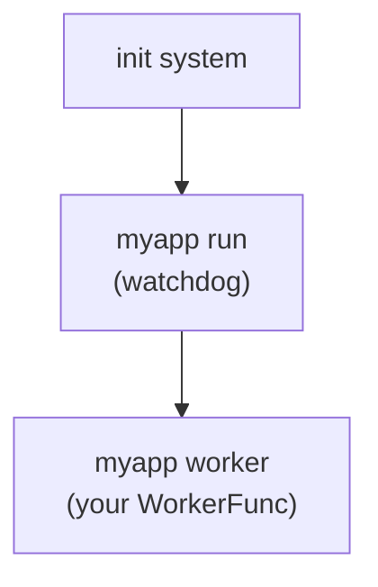

# Quick Start

This walkthrough turns an ordinary HTTP server into a service that installs
itself, survives crashes, and reports its own state.

First initialize your application's Go module and follow
[Installation](installation.md#add-the-module) to configure its dependencies.

## 1. Write the Service

```go
package main

import (
	"context"
	"errors"
	"log"
	"net/http"
	"time"

	"github.com/ovineko/daemonpilot/pkg/daemonpilot"
	_ "github.com/ovineko/daemonpilot/pkg/daemonpilot/setup"
)

func main() {
	s, err := daemonpilot.New(daemonpilot.Config{
		Name:        "myapp",
		Description: "My long-running service",
		WorkerFunc:  workerMain,
	})
	if err != nil {
		log.Fatal(err)
	}
	if err := s.Run(); err != nil {
		log.Fatal(err)
	}
}

func workerMain(ctx context.Context) error {
	srv := &http.Server{Addr: ":8080"}

	go func() {
		<-ctx.Done()
		shutdownCtx, cancel := context.WithTimeout(context.Background(), 10*time.Second)
		defer cancel()
		_ = srv.Shutdown(shutdownCtx)
	}()

	if err := srv.ListenAndServe(); !errors.Is(err, http.ErrServerClosed) {
		return err
	}
	return nil
}
```

`WorkerFunc` is your application. It receives a context that is cancelled when
the service is stopping, so shut down cleanly and return.

## 2. Build

```bash
go build -ldflags "\
  -X github.com/ovineko/daemonpilot/pkg/daemonpilot.Version=1.0.0 \
  -X github.com/ovineko/daemonpilot/pkg/daemonpilot.WatchdogVersion=1" \
  -o myapp
```

## 3. Install

```bash
sudo ./myapp install
```

For a systemd or launchd system-scope install, `install` writes the manifest and
starts the service, with boot startup configured. Other managers have different
capabilities; see [Init Systems](../guides/init-systems.md). On Windows, use an
Administrator terminal and `myapp.exe install` rather than `sudo`.

## 4. Operate

```bash
/opt/myapp/myapp status           # is it running?
sudo /opt/myapp/myapp restart     # stop and start again
sudo /opt/myapp/myapp stop        # stop, leave it installed
sudo /opt/myapp/myapp disable     # disable auto-start, where supported
sudo /opt/myapp/myapp uninstall   # stop and remove the service
```

These paths use the Linux system-scope default. The installed binary is not
automatically added to `PATH`; on macOS the default is `/usr/local/bin/myapp`.
`disable` is unsupported on launchd and can also stop a running service on some
other managers. `uninstall` leaves the install directory and application data.

The full list is in the [CLI reference](../reference/cli.md).

## What Just Happened

The installed service runs `myapp run`, the watchdog. The watchdog spawns
`myapp worker` as a child process and supervises it:



If the worker crashes, the watchdog restarts it with exponential backoff —
1s, 2s, 4s, up to 60 seconds. Once a worker has run for five minutes, the
backoff counter resets. If the whole machine reboots, the init system starts the
watchdog again.

## Next Steps

- Add a [health check](../guides/health-checks.md) so a hung worker is restarted
- Signal [readiness](../guides/readiness.md) once initialization finishes
- Enable [signed self-update](../guides/self-update.md)
- Review the [configuration reference](../reference/configuration.md)
