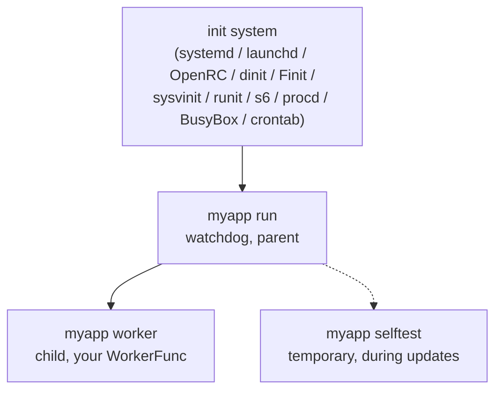
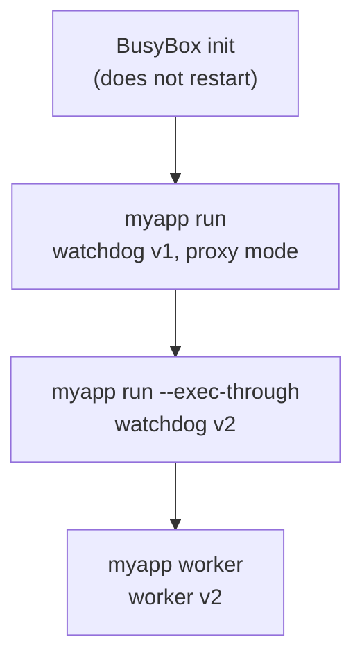

# Architecture

## Process Hierarchy

One binary runs in several modes. The init system starts the watchdog, and the
watchdog runs your code in a separate process:

Separating the watchdog from the worker isolates application panics and allows
update download and verification while the old worker runs. Applying an update
still interrupts service while processes restart; this is not a zero-downtime
handoff. Shared host resource exhaustion, including an OOM event, can affect
both processes.

The watchdog delegates generic process mechanics to `github.com/ovineko/procguard`.
A `Supervisor` owns worker launches, backoff, process-tree cleanup, and stop races.
Daemonpilot owns IPC and readiness, health checks, exit-code requests, update decisions,
probation/rollback, init-system integration, metrics, and persistent state. Runtime
snapshots come from supervisor state; lossy lifecycle events only feed logging.
Probation uses the worker leader's liveness and start time. A crashed worker never
counts as stable while procguard finishes cleaning up its descendants.

## The Restart Loop

The watchdog spawns the worker and waits for it. When the worker exits and no
shutdown was requested:

1. The restart counter increments.
2. Backoff is reset if there is evidence the worker was healthy — it signalled
   readiness, or it ran longer than `StableThreshold` (5 minutes by default).
3. The watchdog waits for the backoff delay — 1s, 2s, 4s, … capped at
   `MaxRestartDelay` (60 seconds by default) — and spawns the worker again.

A restart that follows a successful update skips the backoff entirely: the new
binary should start immediately, not serve a penalty earned by the old one. A
restart triggered by a failing health check does _not_ reset the backoff — a
health failure is a failure, and a repeating one must slow down like any other.

## Worker Process Trees

On Unix, workers and exec-through children run in separate process groups. On
Windows, procguard assigns each launch to a kill-on-close Job Object. Requested
stop gives the whole unit `GracefulTimeout`, then kills remaining members.
Unix sends group SIGTERM first; Windows has no equivalent polite signal and
allows voluntary exit until the deadline. A leader exiting does not shorten the
descendants' grace window.

On Linux, macOS, and Windows, a natural leader exit also starts descendant cleanup,
and an empty unit completes promptly. FreeBSD/OpenBSD (and NetBSD/DragonFly)
cannot enumerate the group reliably: requested stop always waits the full grace
and sends SIGKILL, while natural leader exit leaves descendants alone. Unix
processes can deliberately escape their process group.

## Orphan Prevention

| Platform   | Mechanism                                                                                    |
| ---------- | -------------------------------------------------------------------------------------------- |
| Linux      | Kernel SIGTERM on parent death, plus cooperative expected-parent PID checks every 5 seconds. |
| macOS, BSD | Cooperative parent PID monitoring detects reparenting every 5 seconds.                       |
| Windows    | Closing the watchdog's Job Object kills its assigned worker/child tree.                      |

Windows worker restarts clean up the assigned tree, rather than only the leader.
Job protection begins after assignment;
there is a small creation-to-assignment window. Linux parent-death SIGTERM can be
handled by the worker; it is not an unconditional kill of all descendants.

`DAEMONPILOT_DISABLE_PARENT_MONITOR=1` disables cooperative worker monitoring for
tests. It does not disable procguard's parent-side process group or Job Object
handling. Daemonpilot retains its own signal handler and logs parent-exit provenance
from `procguard.WatchParent`.

## Runtime State over IPC

The watchdog holds the state a worker cannot know about itself: restart count,
current backoff, uptimes, health-check results, update status. It exposes them
over inherited anonymous pipes, and `daemonpilot.GetRuntimeInfo()` reads them from
inside the worker. Static facts — mode, versions, init system, binary path —
travel in environment variables instead, so they are available even when the
watchdog is unreachable. See [Observability](observability.md).
Windows cannot inherit these pipe descriptors through `exec.Cmd.ExtraFiles`, so
workers run without IPC there. Runtime information contains only static fields;
explicit watchdog readiness and watchdog log collection are unavailable.

## Exec-Through

Some init systems run a process once and never restart it: sysvinit, BusyBox
init, and the crontab fallback. Replacing the watchdog binary there cannot mean
"exit and let init start the new one", because nothing would start it.

For a staged update, the running watchdog stays alive as a proxy and runs the
new binary as its child:

The root watchdog stops supervising the worker directly and forwards signals to
the child; the child supervises its own worker normally. When a third version
arrives, the chain collapses rather than growing: the child replaces the binary
and exits, and the root restarts it from disk. At most two watchdog processes
exist at any time.

With staged stability rollback enabled, the child owns worker probation while
it runs. It commits a stable worker or restores the verified previous binary
and exits 0 for immediate proxy restart. The proxy acts only after repeated
child crashes or start failures; it never commits based on watchdog uptime.
If the proxy restores the previous watchdog and that also repeatedly fails,
`OnCriticalFailure` is invoked. Details in [Self-Update](self-update.md#rollback).
